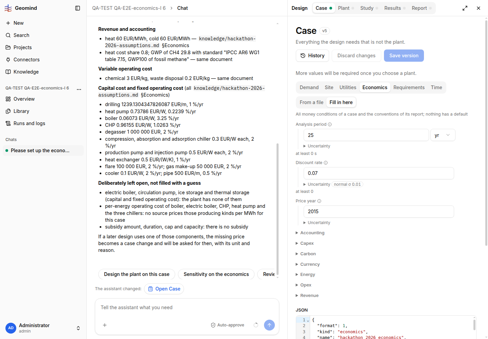
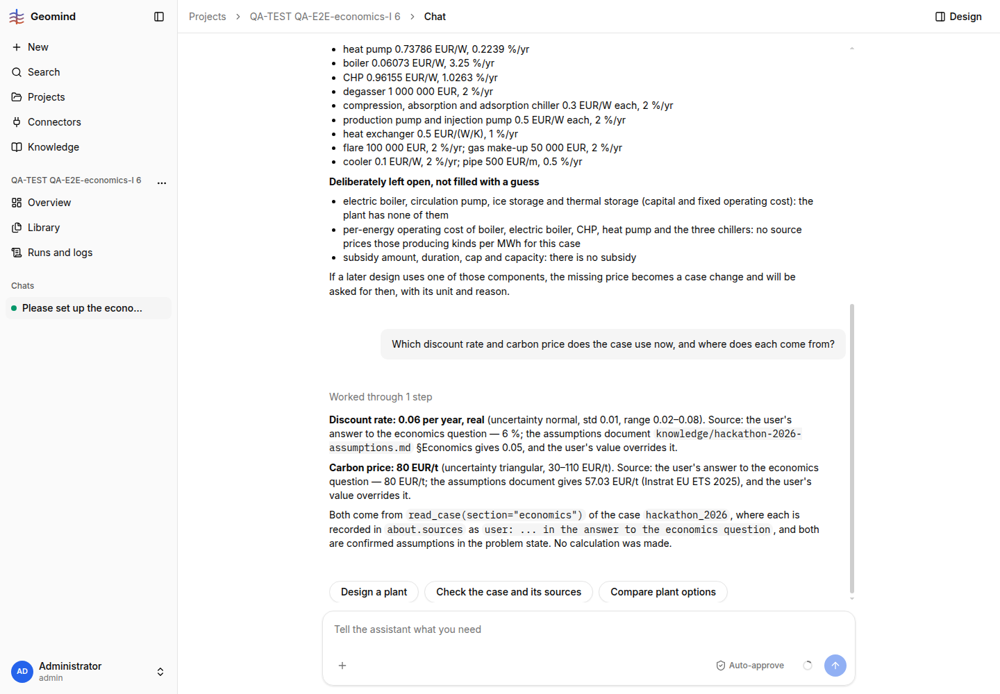

# QA-284: Economics edited by hand on the Case page (discount 0.07, case v5) is not what the agents read: a new chat's read_case still gives 0.06 with the old source; the hand edit keeps the stale source and leaves economics.json orphaned

| Field | Value |
|---|---|
| Status | verified |
| Severity | major |
| Area | geomind |
| Reporter | QA-E2E-economics-I |
| Found | 2026-11-05 18:31 UTC |
| Versions | backend 1.1.110+ (geomind 0.4.110+), frontend live 2026-11-05 18:30 UTC |
| Where | https://geomind.team/projects (project "QA-TEST QA-E2E-economics-I 6", see Steps); new chat 88a4f235-06de-4595-9739-1da2c77e07a9; run d66897ee-05a6-478d-8d22-3486abda42e6 |
| Fixer | |

## Steps

1. Project 6: economics set by chat (run 74ef2d84): `economics.json`, discount 0.06 with source
   "user: 6 % in the answer to the economics question", case v4.
2. Case > Economics > Fill in here: the form loads the file (QA-185 fix); change Discount rate to
   0.07; Save version, note "QA: discount rate 7 % by hand (municipal financing)" -> case v5
   (18:30:36 UTC). Screenshot 1.
3. A NEW chat: "Which discount rate and carbon price does the case use now, and where does each
   come from?" (18:30:55 UTC).

## Expected

The agents read the project's latest case (v5): discount rate 0.07, source "edited by hand on the
Case page, v5, <note>"; and the hand edit records its own source.

## Actual

- The analysis lead's `read_case {"section":"economics"}` returns discount_rate 0.06 with source
  "user: 6 % ..." and answers "Discount rate: 0.06 per year" (screenshot 2). The project's case is
  0.07 (API `/design/case`: v5, `economics` now an inline object with `discount_rate.value`
  0.07).
- In the stored case v5 the source of `discount_rate` is still "user: 6 % in the answer to the
  economics question": the form saves the value but not a new source.
- v5 holds the economics inline while `economics.json` (0.06) stays in the case files, now unused
  by the case but still listed; two copies that disagree.
- Minor: while streaming, the answer's last sentences were not shown (it ended at "80 EUR/t;");
  after a reload the full text was there.

## Evidence

- 
- 
- Run JSON: `../evidence/QA-284/run-d66897ee.json.gz` (read_case output: discount 0.06)

## Cause

Fact: `read_case` reads `context.problem.case` (`geomind/tools/gemini/case.py` `state_case`), the
problem state's case, not the project's latest case version; the new chat's state was seeded with
the case as the assistant last accepted it (v4), not the hand-saved v5. Guess: the backend's
`Workspace` seeds the chat state from the accepted case and does not see a later version saved by
hand.

## Proposed fix

1. geomind/backend: a run starts from the project's LATEST case version (or `read_case` checks the
   version and reloads); when the user saved a version by hand since the state's case, the agents
   see it (and can say "the case changed by hand in v5").
2. frontend Case page (or backend save): a value changed in the form gets
   `about.sources.<key> = "edited by hand, case v<n>: <note>"`.
3. When economics move from a file to inline, drop or mark the old `economics.json`.

## Fix

- 2026-11-05 18:55 UTC: deploy 36: backend 1.1.118, geomind 0.4.130, gemini 0.6.26 (hotfix-python-lead-II)
## Retest

- 2026-11-05 18:57 UTC, QA-E2E-economics-I: main part PASSES on backend 1.1.118. Project 6, new
  chat "Which discount rate does the case use now ...?" -> "0.07 ... the case you saved by hand"
  and it flags that the stored source note is stale. `economics.json` is gone from the case files
  after the next save (v7). Still failing, filed separately as QA-305 (minor): a hand save
  (v7, discount 0.065, 18:57 UTC) keeps `about.sources.discount_rate` = "user: 6 % in the answer
  to the economics question".
- 2026-11-05 18:57 UTC: QA-E2E-economics-I 18:57 UTC backend 1.1.118: agents read the hand-saved value; stale source split to QA-305
