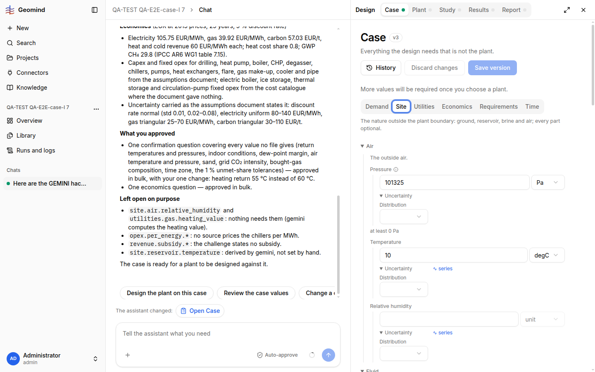
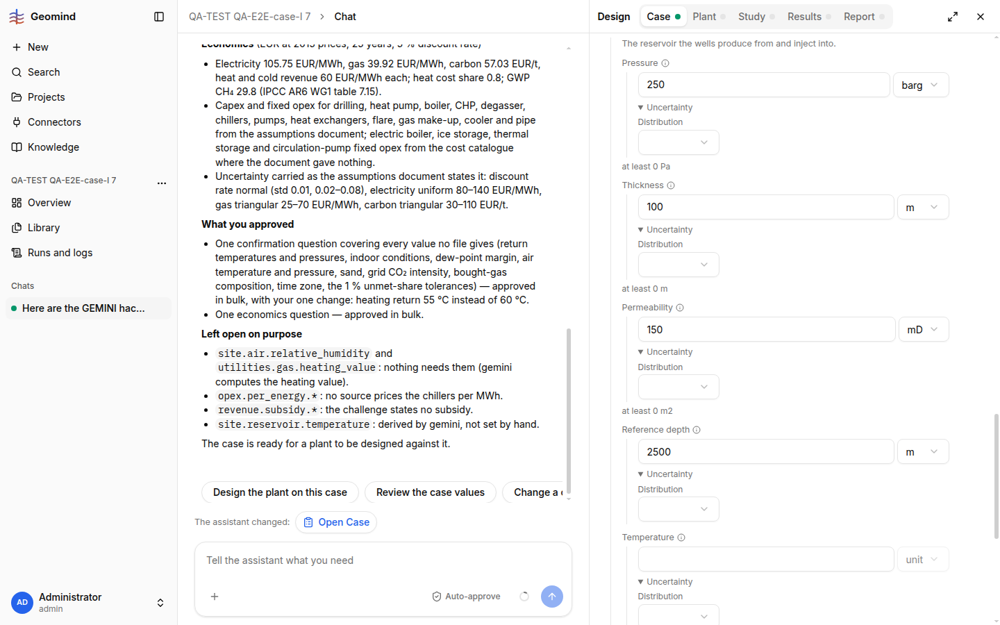

# QA-286: Case page Site form shows float32 noise: viscosity 0.4000000059604645, gas liquid ratio 0.800000011920929 (case holds 0.4 and 0.8); bound hints in SI ('at least 0 Pa' under barg, '0 m2' under mD)

| Field | Value |
|---|---|
| Status | fixing |
| Severity | cosmetic |
| Area | frontend |
| Reporter | QA-E2E-case-I |
| Found | 2026-11-05 18:33 UTC |
| Versions | frontend 1.1.113, backend 1.1.115 |
| Where | https://geomind.team/projects/a60df495-3c12-4dfe-85f7-f678c2df933b/design/case, tab Site; project QA-TEST QA-E2E-case-I 7, case v3 |
| Fixer | hotfix-front-lead |

## Steps

1. Case set by chat (`site.fluid.viscosity` 0.4 mPa.s, `gas_liquid_ratio` 0.8 Nm3/m3; API `GET /design/case` returns 0.4 and 0.8).
2. Open Case > Site, open Fluid and Reservoir.

## Expected

The fields show 0.4 and 0.8; the bound hint is in the field's unit.

## Actual

Viscosity field: `0.4000000059604645`, Gas liquid ratio: `0.800000011920929` (snapshot of the spinbuttons, ).
Saving a version after changing only permeability did not write the noise (v4 differs from v3 only in
permeability: checked by diff), so it is display only. Under Pressure (barg) the hint says "at least 0 Pa",
under Permeability (mD) "at least 0 m2" (). Already noted as cosmetic in QA-063 (2026-11-0x), still there.

## Evidence

- Screenshots 1.png, 2.png.

## Cause

Guess: the form converts through Float32 (or a float32 typed array) for display; the hint prints the SI bound of gemini's schema without converting to the selected unit.

## Proposed fix

frontend Case form: keep the JSON number as is (Float64), or round for display to 12 significant digits; convert the schema bound to the field's unit for the hint.

## Fix

## Retest
