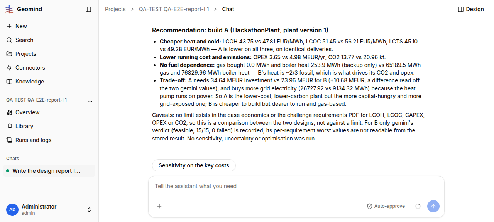

# QA-289: 'Short form for my manager' comparison answer is 470 lines: it re-prints the whole earlier v1 design report before the 2-plant table

| Field | Value |
|---|---|
| Status | open |
| Severity | minor |
| Area | geomind |
| Reporter | QA-E2E-report-I |
| Found | 2026-11-05 18:36 UTC |
| Versions | backend 1.1.109+ (geomind 0.4.110+), frontend bundle index-TsXgd_n9.js |
| Where | https://geomind.team/projects/0e44cb05-6096-434e-95ee-56b434898015/assistant/chat/b31664b0-44c2-4d20-9ee7-987f592b5aff; run cb6ce579-1959-45e2-8ab0-37f70074ca1e (18:24:23-18:35:23 UTC) |
| Fixer | |

## Steps

1. In the chat of QA-233 (report of v1 already given), ask: "Compare the two plant versions in
   this project for my manager: which one would you build and why? Give the key figures side by
   side, in a short form."

## Expected

A short answer: one table v1 vs v2 and a 3-5 line recommendation.

## Actual

The answer has two parts: "1. Design report - HackathonPlant, plant version 1" (about 360
lines: modules, connections, capacities, KPIs, checks, the same report as the previous answer)
and "2. The two plant versions side by side". Part 2 is correct and useful: recommend v1, LCTS
45.10 vs 49.28 EUR/MWh, CO2 13.77 vs 20.96 kt, CAPEX 34.64 vs 23.96 MEUR, figures from gemini
compare, equal to both page studies. Values are unrounded (QA-234). 11 min, 84 steps
(14 retried), 1.61 M input tokens, 0.044 USD.

## Evidence

- 
- Answer text: `../evidence/QA-289/chat-answer.txt` (part 2 from line 364)

## Cause

Guess: the project lead's finish concatenates the explainer's earlier report (kept in the
problem state as the last answer) with the new comparison, or the explainer is briefed to
"write the report" again.

## Fix

Proposal: prompt `project/lead` / explainer: answer only the new question; a format the user
asks for ("short form", "for my manager") limits the length; never repeat an earlier answer.

## Retest

(Who, when, result.)
