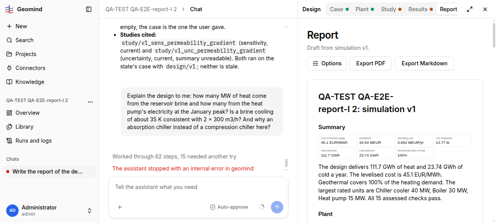

# QA-290: Report page gives no warning that its result ran on case v3 after the case changed to v4: header 'Draft from simulation v1', only a small 'From case version 3' under Costs; Export PDF the same

| Field | Value |
|---|---|
| Status | fixed |
| Severity | minor |
| Area | frontend |
| Reporter | QA-E2E-report-I |
| Found | 2026-11-05 18:37 UTC |
| Versions | backend 1.1.109+, frontend bundle index-TsXgd_n9.js |
| Where | https://geomind.team/projects/fa329839-43df-48c3-81c3-89af503b92c0/design/report; project QA-TEST QA-E2E-report-I 2 |
| Fixer | hotfix-front-lead |

## Steps

1. Project with result "simulation v1" on case v3.
2. Change the case (here heating return temperature 60 -> 50 degC, saved as case v4 with the
   same call the Case page makes).
3. Open the Report page.

## Expected

A clear note at the top of the report (and in the PDF/Markdown): "This result ran on case
version 3; the case is now version 4. Run the study again before you send this report." The
Study and Results tabs already say "Out of date".

## Actual

Tabs: Study "Out of date", Results "Out of date"; Report "Draft". Report header: "Draft from
simulation v1." Nothing else, except "From case version 3, plant version 1." under Costs.
The PDF/Markdown export carries no warning either (checked the Markdown of the same report
before the change: no case-version note in the header).

## Evidence

- 

## Cause

Guess: the Report page does not compare the result's case_version with the project's current one.

## Fix

Proposal (frontend): when result.case_version or plant_version differs from the current
versions, show an "Out of date" banner on the Report page and add the same line to the
exported header (backend export, if the text is built there).

Fix: frontend 1.1.129 (commit da9da17, bundle index-DjK0zKa6.js), by front-m2: report-editor.tsx shows an 'Out of date' alert with the run's and the project's case/plant versions. PDF/Markdown note open for backend.
- 2026-11-05 18:54 UTC: frontend 1.1.129
- 2026-11-05 19:30 UTC: retest QA-E2E-report-I: case banner works; false 'Out of date' on a current result of plant v1 because v2 (another plant) exists
- 2026-11-05 19:49 UTC: frontend 1.1.137
## Retest

QA-E2E-report-I, 2026-11-05 19:35 UTC, backend 1.1.122, project QA-TEST QA-E2E-report-I 2: the banner works for a real case change: result "simulation HackathonPlant" (case v3) shows "Out of date. This result ran on case version 3, plant version 1; the project now has case version 4, plant version 2. Run the study again before you send this report." (screenshot 2). BUT it is a false alarm on a current result: "simulation HackathonPlant case v4" (page study of plant v1 on case v4, made at 19:00 UTC) shows "Out of date ... ran on case version 4, plant version 1; the project now has case version 4, plant version 2" (screenshot 3). Plant v2 is another plant (HeatingAbsorptionCoolingPlant), not a newer v1, so every report of v1 (the plant the agents recommend, QA-289) is marked out of date and "run the study again" cannot clear it. Proposal: flag the plant only when the result's plant version is older than the latest version of the SAME plant (same name/lineage, e.g. a version saved from it by patch or adopt), or say "a newer plant version exists" as an info line, not "Out of date"; the case check stays. Reopened.

Fix 2 (reopen): frontend 1.1.137 (bundle index-zeGpNIjj.js), by front-m2: `toStaleness` in shared/api/results.ts; only a newer case is 'Out of date' (Report, Results, Study, tab dots, Overview); a newer plant version is a muted note, since it may be another plant.

QA-E2E-report-I, 2026-11-05 20:10 UTC, backend 1.1.125, project 2 Report page: result 'simulation HackathonPlant case v4' (plant v1, current case v4) shows no banner; result 'simulation HackathonPlant' (case v3) shows 'Out of date: the case changed (version 3, now 4) after this result was made. Run the study again to update it. Do this before you send this report.' The existence of plant v2 no longer flags a v1 result. Verified.
