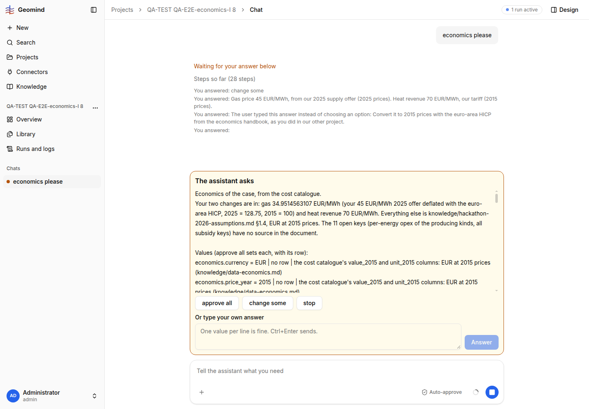

# QA-298: ask_economics shows values given as {value, unit} objects as raw dicts and checks them only after approve all: 76 problems, the approve all is lost ('You answered:' empty) and the next card drops discount, prices and carbon to Open

| Field | Value |
|---|---|
| Status | fixed |
| Severity | major |
| Area | geomind |
| Reporter | QA-E2E-economics-I |
| Found | 2026-11-05 18:47 UTC |
| Versions | backend 1.1.116 (geomind 0.4.12x) |
| Where | project "QA-TEST QA-E2E-economics-I 8"; run 658ca8f2-504f-4dc5-b568-ee65e62cc62c; analysis_lead steps 10-21 |
| Fixer | hotfix-python-lead-II |

## Steps

1. Reference case, no economics. Chat: "economics please" (18:34:26 UTC). The ANALYSIS lead
   answers (not the case lead) and asks the economics question at 18:35:43 (77 s).
2. Press "change some". It asks in free text which keys; answer "Gas price 45 EUR/MWh, from our
   2025 supply offer (2025 prices). Heat revenue 70 EUR/MWh, our tariff (2015 prices)."
3. It asks how to treat the 2025 price, offering only (a) "I will give the 2015 value" or (b)
   "record 45 as it stands, 2025 price noted" ("I never convert a price year myself"). Typed:
   "Convert it to 2015 prices with the euro-area HICP from the economics handbook".
4. A new full economics card (step 20). Press approve all (18:46:41).

## Expected

The re-ask shows "25 yr", "1239.13 EUR/m" etc., is checked before it is shown, and approve all
sets it (gas 34.9515 EUR/MWh with its HICP source, heat 70).

## Actual

- The step-20 card shows about 40 values as Python dicts:
  `economics.analysis_period = {'value': 25, 'unit': 'yr'}`,
  `economics.capex.drilling = {'value': 1239.1304347826087, 'unit': 'EUR/m'}` ...
  (`card-dict-values.txt`), and gas with 12 digits (34.9514563107).
- On approve all, `ask_economics` fails: `invalid_unit ... the case has problems at 76 paths:
  economics.analysis_period.unit: unit is missing; ... value = {'unit': 'yr', 'value': 25};
  expected a number` (run JSON, step 20 output). Nothing is set.
- The chat shows "You answered:" with an EMPTY answer, and a 4th card follows in which
  discount_rate, analysis_period, electricity, gas and carbon price are now under "Open", and
  opex.per_energy rows from the catalogue were added instead (`card-after-approve-all.txt`,
  screenshot 1). A user who presses approve all again gets an economics without prices.
- Also: the price-year question contradicts project 4 (run 236f17d4), where the case lead itself
  recommended deflating with the HICP from handbook-economics §4.2; option (b) would mix price
  years in one case.
- 5th card (step 21, 18:49 UTC), after I typed that discount, period, prices and carbon must not
  be open: the note says "Discount rate 0.05, analysis period 25 yr, electricity 105.75 ... are
  back in", but EVERY key of the assumptions file is listed under "Open"; only 7 catalogue rows
  remain under approve all (`card-5-all-open.txt`). The call passed each value as
  `{"key": "discount_rate", "source": ..., "uncertainty": ...}` with NO `value`; ask_economics
  silently moved them to Open instead of refusing the call, so the note and the list contradict.
- Speed: 13 min so far for two changed values; 4 question cards.

## Evidence

- 
- Cards: `../evidence/QA-298/card-price-year.txt`, `card-dict-values.txt`,
  `card-after-approve-all.txt`
- Run JSON: `../evidence/QA-298/run-658ca8f2.json.gz` (analysis_lead steps 10, 11, 12, 20)

## Cause

Fact: the analysis lead passed each value of `ask_economics` as `{"value": {"value": 25, "unit":
"yr"}}` (an object where a number belongs). `ask_economics` renders it with `str()` and runs the
case check only in `on_answer` (cf. QA-004, which made the unit check happen before the user is
asked; this shape escapes it). The failed `on_answer` error goes back to the model, the chat shows
the answer text as empty.

## Proposed fix

geomind `tools/gemini/economics.py`:
1. Validate every value's shape and unit (the full case check, as `precheck`) BEFORE asking;
   accept `{value, unit}` objects by unwrapping them, or refuse the call with the path.
2. Refuse a value entry without `value` (or `row`) instead of moving it to Open; the note may
   never claim a key is set when the list shows it open.
3. When `on_answer` fails, keep the user's "approve all" in the chat record and re-ask with the
   SAME values fixed, never drop keys to Open.
4. Analysis/case lead skill: the price-year rule from handbook-economics §4.2 (deflate a user
   price with the euro-area HICP and show it) in both leads; never offer to mix price years.

## Fix

- 2026-11-05 19:12 UTC: geomind main 71d80ab (0.4.131+), gemini dev 5782a138 (0.6.27); QA-312 also needs back-lead's DatabaseWorkspace.save_plant_version
## Retest
