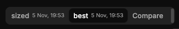

# QA-311: Results tab toggle bar (sized / best / Compare) shows a scrollbar on its right edge although the tabs fit

| Field | Value |
|---|---|
| Status | fixed |
| Severity | minor |
| Area | frontend |
| Reporter | Sahand (screenshot) |
| Found | 2026-11-05 19:00 UTC |
| Versions | live 2026-11-05 19:59 Trondheim |
| Where | geomind.team Results page, the result tab toggle bar (e.g. 'sized', 'best', 'Compare') |
| Fixer | hotfix-front-lead |

## Steps

1. Open Results of a project with two or more results.

## Expected

No scrollbar when the tabs fit; when they do not fit, scroll horizontally with the scrollbar hidden (or wrap), never a vertical scrollbar beside the buttons.

## Actual

A scrollbar shows at the right edge of the toggle bar (screenshot).

## Evidence

- 

## Cause

Guess: the toggle container has overflow:auto and a fixed height a few px smaller than the buttons (focus ring or border), so a vertical scrollbar appears. Sahand's bug: top priority.

## Fix

(Hotfix session: cause, commit, version, deployed at.)

Fix: frontend 1.1.131 (bundle index-PVHgYO42.js), by front-m2: TabsList overflow-y-hidden and h-auto; no scrollbar when tabs fit.
- 2026-11-05 19:14 UTC: frontend 1.1.131
## Retest

(Who, when, result.)
