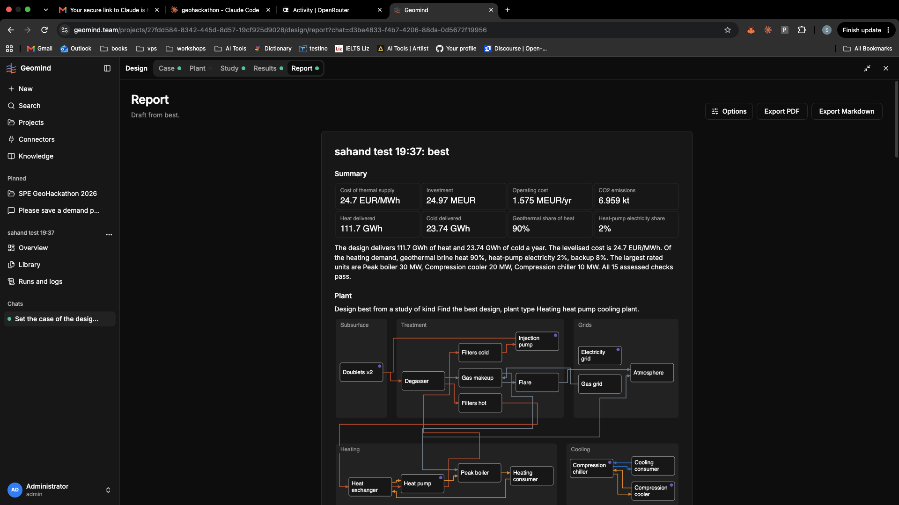

# QA-313: Task: Report draft needs structure and text: numbered sections and subsections, and a few lines of explanation with every chart and table

| Field | Value |
|---|---|
| Status | fixing |
| Severity | major |
| Area | backend,frontend |
| Reporter | Sahand (screenshot) |
| Found | 2026-11-05 19:04 UTC |
| Versions | live 2026-11-05 20:02 Trondheim |
| Where | geomind.team Design > Report ('Draft from best'), also Export PDF / Markdown |
| Fixer | hotfix-front-lead |

## Steps

1. Open Report of a project with a simulated result.

## Expected

A structured, readable engineering report (also in PDF/Markdown export), e.g.:
1. Summary (KPI tiles + 3-5 sentence conclusion: what was designed, does it meet demand, cost, CO2, main risk)
2. Case and demand (site, reservoir, demand profiles; text on peaks and annual totals; sources)
3. Plant design (3.1 subsurface, 3.2 treatment and gas, 3.3 heating, 3.4 cooling, 3.5 grids; flowsheet with a paragraph on how energy flows and why each unit is there; sizing table with a line per main unit)
4. Performance (heat/cold delivered vs demand, coverage by source, days covered; each chart with 2-4 lines saying what it shows and the key number)
5. Economics (capex/opex breakdown table, LCTS/NPV, text on the cost drivers)
6. Emissions (CO2 by source, text)
7. Studies (sensitivity tornado, uncertainty P10/P50/P90, optimisation/comparison; each with a short reading)
8. Checks and verification (checks table + text on any warnings)
9. Assumptions and sources (table)
Every chart and table has a caption and a short paragraph generated from the result numbers (no fixed boilerplate, general wording, nothing competition-specific baked in).

Typography and layout (Sahand, 20:06 CET): more space between sections and subsections (clear vertical rhythm: larger gap before each heading than after it); headings visibly larger and bolder per level; paragraph width limited for reading (~70-80 characters); captions under each chart/table in a smaller muted style; consistent number formatting (units, thousands separators, 2-3 significant digits); tables with aligned numeric columns; no dense blocks, KPI tiles not crammed; page breaks between main sections in the PDF; the same spacing in the PDF and Markdown exports. Follow normal technical-report writing practice.

## Actual

KPI tiles, one summary paragraph, then mostly charts and tables with almost no text and no section numbering (screenshot).

## Evidence

- 

## Cause

Sahand's request (top priority). Backend report draft builder: add the section tree and generate the explanatory text from the result (numbers, rankings); frontend: render headings, captions and paragraphs (and the same in PDF/Markdown export). If the text should come from the explainer agent, geomind part to hotfix-python-lead. Follow handbook-report (Knowledge) section structure where it fits.

## Fix

Backend 1.1.123 (numbered sections 1-9, subsections, captions and paragraphs, PDF typography), hotfix-back-lead-II.

(Hotfix session: cause, commit, version, deployed at.)

## Retest

Report draft and PDF export: numbered sections, caption and text after every figure and table.

(Who, when, result.)
