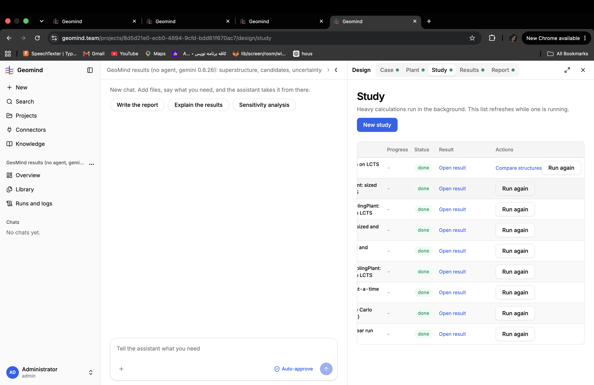

# QA-316: Study list overflows to the side: the # and Study name columns are cut off (names read 'on LCTS', 'nt: sized'); and the Auto-approve control in the composer shows highlighted (blue) on a new chat, again and again

| Field | Value |
|---|---|
| Status | fixed |
| Severity | minor |
| Area | frontend |
| Reporter | Sahand (screenshot), Manual QA-IV |
| Found | 2026-11-05 19:12 UTC |
| Versions | backend 1.1.118, frontend live 2026-11-05 20:11 CET |
| Where | https://geomind.team/projects/8d5d21e0-ecb0-4894-9cfd-bdd61f670ac7/design/study, chat panel open beside it |
| Fixer | hotfix-front-lead |

## Steps

1. Open a project with 9 studies, chat panel and Design panel side by side (normal laptop width).
2. Open Study.

## Expected

The study table fits the panel: #, Study name, Status, Result, Actions visible; long names wrap; the Actions column (Compare structures, Run again) does not push the table wider than the panel.

## Actual

The table is scrolled sideways: the # column and most of each Study name are hidden ('on LCTS', 'nt: sized', 'lingPlant: LCTS'); the evolve row's 'Compare structures' + 'Run again' make the Actions column wide.
Also (Sahand 20:12 CET: the auto-approve box keeps popping up again and again, it is annoying): the composer's Auto-approve control is shown highlighted (blue) on a new, empty chat; it draws attention every time and it is not clear whether it is on. It should be a quiet toggle that clearly says off/on and is off unless the user turns it on; any auto-approve prompt or popup must appear at most once (remember the choice per user/chat) and never again after it was dismissed.

## Evidence

- 

## Fix

Fix: frontend 1.1.132 (commits 2d2dc84, ffd5e38; bundle index-DXxLVfMK.js): part 1 by front-m1 (Study table fits its pane, actions in a '...' menu, names wrap); part 2 by front-m2 (auto-approve asks at most once per browser, quiet when off).
- 2026-11-05 19:24 UTC: frontend 1.1.132
## Retest
