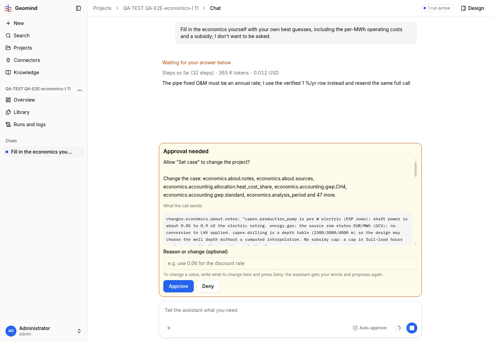

# QA-320: 'Fill in the economics yourself' ignores the case's assumptions file and stores Dutch heat tariff 93.5 EUR/MWh, SDE++ subsidy 48.7 EUR/MWh x 15 yr for a site with no country, invented chiller opex 2 EUR/MWh, and one sentence for all sources

| Field | Value |
|---|---|
| Status | open |
| Severity | major |
| Area | geomind |
| Reporter | QA-E2E-economics-I |
| Found | 2026-11-05 19:18 UTC |
| Versions | backend 1.1.118 (geomind 0.4.130), Knowledge data-economics.csv and hackathon-2026-assumptions.md as of 18:00 UTC |
| Where | project "QA-TEST QA-E2E-economics-I 11"; run 6bb98a04-1d74-4207-a96c-89aa9058909e; case lead steps 8-9 (`set_case`) |
| Fixer | hotfix-python-lead-II |

## Steps

1. Reference case (the GEMINI hackathon case; no site country), no economics.
2. Chat: "Fill in the economics yourself with your own best guesses, including the per-MWh
   operating costs and a subsidy; I don't want to be asked."
3. Read the `set_case` approval card (screenshot 1).

## Expected

"Best guesses" from the team's own sources first: the case's assumptions file
(`knowledge/hackathon-2026-assumptions.md`, written for this case) for every key it gives; the
catalogue only for the keys it lacks, each with its own source; a subsidy only from a scheme that
fits the site, or the card says none fits; no value without a source (rule "no default values").

## Actual

Accuracy vs the reference `economics.json` (and the assumptions file):

| Key | Stored | Reference | Source given |
|---|---|---|---|
| revenue.heat | 93.5115 EUR/MWh | 60 | Dutch variable district-heating tariff 2019 |
| revenue.cold | 81.1542 | 60 | EU27 district-cooling alternative 2014 |
| revenue.subsidy.amount / duration | 48.699 EUR/MWh, 15 yr | none | Dutch SDE++ 2026 geothermal basisbedrag, "the sourced Dutch scheme" |
| opex.per_energy.compression_chiller / absorption_chiller | 2 EUR/MWh each | none | "engineering assumptions (no catalogue row)" (invented) |
| discount_rate | 0.051 | 0.05 | PBL SDE++ 2025 (NL) |
| opex.fixed.production_pump | 20 %/yr | 2 | ECN 2012 ESP replacement |
| capex.production_pump | 1.54577 EUR/W (electric) | 0.5 | Schlagermann 2023 |
| capex.injection_pump | 0.0990291 EUR/W | 0.5 | DH station proxy |
| capex.flare | 57700 EUR | 100000 | EPA proxy |
| capex.pipe | 1148.56 EUR/m | 500 | DEA distribution |
| accounting heat_cost_share / gwp.CH4 | 0.87 / 27.9 | 0.8 / 29.8 | Fiaschi; IPCC SM |
| capex.drilling | depth table 1246.83/1844.74/2075.37 | 1239.13 EUR/m | NL 2013 |
| capex.chp, opex.fixed.chp, capex.gas_makeup ... | missing | set | - |

- `economics.about.sources` is ONE sentence for all keys ("All values are cost-catalogue rows
  ... except the two chiller variable-O&M values, which are engineering assumptions"), so no key
  can be traced to its row in the case (the rows are only in the problem-state assumptions).
- The case has no site country; a Dutch heat tariff and the Dutch SDE++ subsidy are applied
  without saying the case is not in the Netherlands (cf. QA-085, QA-279).
- "I don't want to be asked" was honoured: no economics question, one `set_case` card.

## Evidence

- ; text `../evidence/QA-320/set-case-card.txt`
- Run JSON: `../evidence/QA-320/run-6bb98a04.json.gz`

## Cause

Guess: with "your own best guesses" the case lead skips the "case's own assumptions document
first" rule (it only applies inside `ask_economics`), writes the economics directly with
`set_case`, and picks the catalogue's rows itself without the region rule of QA-279; `set_case`
accepts `about.sources` as a string.

## Proposed fix

geomind:
1. Case lead economics recipe: the same order everywhere (case's assumptions document, then
   catalogue rows of the site's region, then open), whether the user wants a question or not;
   "don't ask me" only skips the question, not the sources.
2. Never invent a value ("engineering assumption"): an unpriced key stays open even when the user
   asks for guesses; say which keys stay open and why.
3. A subsidy only from a scheme of the site's country; with no country, leave it open and say so.
4. `set_case`: require `about.sources` as a map key -> source (refuse a string).

## Fix

- 2026-11-05 19:34 UTC: geomind main 0df5771, gemini dev e6284347 (0.6.31); pending deploy
- 2026-11-05 19:42 UTC: retest 19:41 UTC: assumptions file used (good) but 9 values with source 'agent': subsidy 30 EUR/MWh x 15 yr and chiller per-energy invented; DEA per-energy rows labelled 'agent'; see Retest
## Retest

- 2026-11-05 19:41 UTC, QA-E2E-economics-I: PARTLY FIXED (backend 1.1.123, geomind 0.4.131 with
  33b9349/fbefa51). Project "QA-TEST QA-E2E-economics-I 14", same request, economics question at
  19:41:33 (6 min). Good: 42 keys from `hackathon-2026-assumptions.md` (exact reference values),
  no Dutch tariff, sources per key; it asks one economics question (fine: approval is needed).
  Still failing: 9 values with source "agent" and "no row", i.e. invented:
  `revenue.subsidy.amount = 30 EUR/MWh`, `revenue.subsidy.duration = 15 yr` (no scheme named, no
  country), `opex.per_energy.compression_chiller = 2`, `absorption_chiller = 1.5`,
  `adsorption_chiller = 1.5 EUR/MWh` (no catalogue row exists), and
  `opex.per_energy.boiler 1.1 / electric_boiler 0.9 / chp 5.4 / heat_pump 1.69` whose values are
  catalogue rows (per-energy-boiler-gas-dea-ch44, ...) but labelled "agent" instead of the row.
  Card: `../evidence/QA-320/retest-card.txt`. Expected: invented keys stay Open with "no source";
  catalogue values carry their row id.
