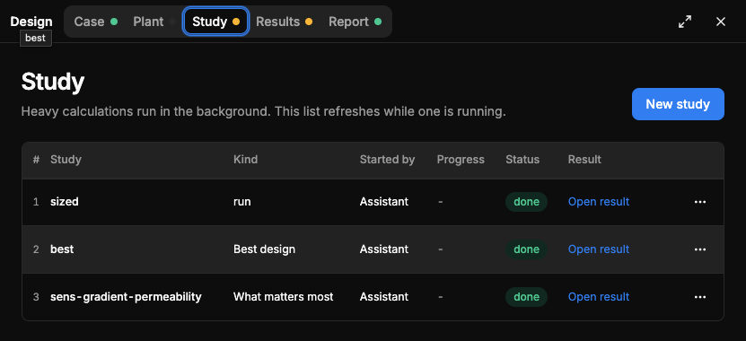

# QA-328: Design tabs: Study and Results show an amber dot with no explanation (no tooltip, no text on the page why it is amber; all studies listed are done); a stray 'best' tooltip sits under 'Design'

| Field | Value |
|---|---|
| Status | fixed |
| Severity | minor |
| Area | frontend |
| Reporter | Sahand (screenshot), Manual QA-IV |
| Found | 2026-11-05 19:29 UTC |
| Versions | frontend live 2026-11-05 20:28 CET, backend 1.1.118 |
| Where | Design panel, Study tab of a project with 3 done studies (sized, best, sens-gradient-permeability), Sahand's screenshot |
| Fixer | hotfix-front-lead |

## Expected

Every tab dot has a meaning the user can see: a tooltip on the dot (for example "Out of date: the plant changed after these studies ran") and the same reason on the page, with the action that clears it (Run again). The legend of the colours (green done, amber needs attention or out of date, grey empty) is visible somewhere.

## Actual

Study and Results have an amber dot; the Study page shows three studies, all 'done', and nothing says why the tab is amber. Plant has a grey dot with no reason either. A small 'best' tooltip floats under the 'Design' title.

## Evidence

- 

## Cause

Guess: the dot is the project progress state (QA-135: 'Out of date' when the plant or case changed after the study); the reason is in GET /workspace/projects/{id}.progress.*.label but not shown on the tab or the page.

## Fix

Fix: frontend 1.1.135 (bundle index-BDDoP4gT.js, by front-m1): every Design tab dot has a tooltip (state, reason, action); stray study-name tooltip removed. Cause of the amber dot (fact): frontend rule overview/stale.ts toStaleSteps marks Study/Results 'Out of date' when the newest result is older than the current case/plant version. Plant grey dot: backend plant_version null, passed to back-lead. frontend 1.1.136 (bundle index-BXjvGV5t.js, by front-m2): Study and Results pages show the same reason as an alert with New study / Run the study.
- 2026-11-05 19:44 UTC: frontend 1.1.135 + 1.1.136
## Retest
