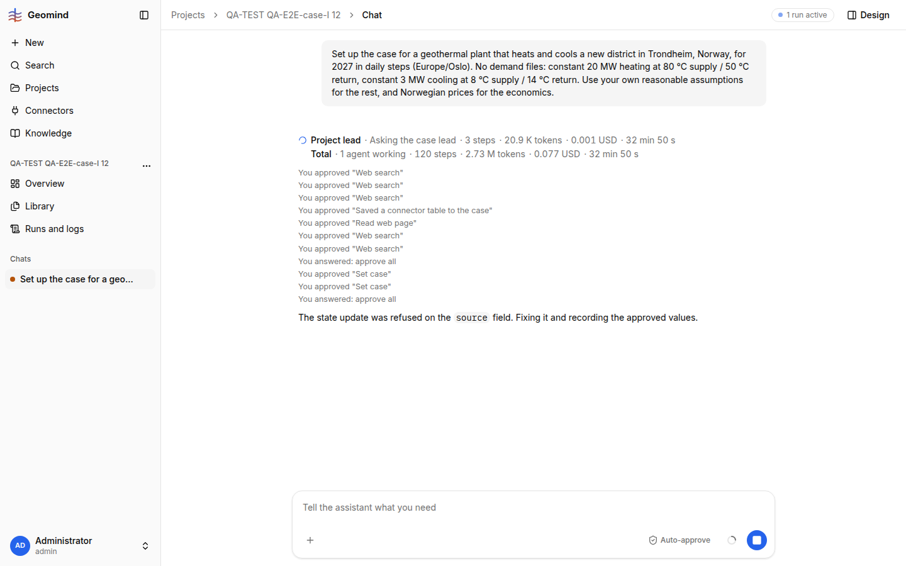

# QA-336: Run waits on the economics question (request-797) but no question event is in /events and the chat shows no card, also after reload: the user cannot answer, the run is stuck

| Field | Value |
|---|---|
| Status | fixing |
| Severity | blocker |
| Area | backend |
| Reporter | QA-E2E-case-I |
| Found | 2026-11-05 19:55 UTC |
| Versions | frontend (bundle index-PVHgYO42.js), backend 1.1.121+ |
| Where | https://geomind.team/projects/331bf443-ac7d-465f-afa2-b5c1e5ece6a8/assistant/chat/54c0c924-2cff-4352-8e26-1b8213ef89dc; project QA-TEST QA-E2E-case-I 12; run 3152a411 |
| Fixer | back-m2 |

## Steps

1. New project, no files: "Set up the case ... Trondheim, Norway ... Norwegian prices for the economics." (19:21:31 UTC)
2. Approve the case question and the two set_case cards (19:27-19:33).
3. The chat shows "The state update was refused on the source field. Fixing it and recording the approved values." and then nothing.

## Expected

The economics question card appears; the user answers; the run goes on.

## Actual

- `GET /assistant/runs?project=331bf443...` (19:45 and 19:55 UTC): status `waiting`, `request.kind: question`,
  agent case_lead, call `call-856f36aa-...`, request-797, "Economics of the case. Where the values come from: 44 from
  catalogue rows, general; 1 ... Denmark; 1 ... Norway ..." with options approve all / change some / stop.
- The chat (two browser sessions, reload) shows no card and no "Waiting for your answer"; 0 "approve all" buttons.
- `GET /assistant/runs/3152a411.../events` (342 kB): the last events are case_lead step.started index 6 at
  19:36:39 and heartbeats; no question / permission event for request-797 (`../evidence/QA-336/events-tail.txt`).
- A deploy happened about then (several "server cannot be reached" in this round). Guess: the run resumed after the worker
  restart and re-asked, but the question event was not published to the stream.

## Evidence

- , `../evidence/QA-336/run-3152a411.json` (run with `request`), events tail.

## Cause

Guess (backend): after a resume, the pending `request` is stored on the run but no `question` event is emitted on
/events, and the frontend builds the card only from events (QA-056 was a similar case for approvals).

## Proposed fix

backend: on resume and on GET of a run in `waiting`, (re)emit the pending request as an event; frontend: when the run is
`waiting` with a `request`, draw the card from `run.request` even if no event came.

## Fix

## Retest
