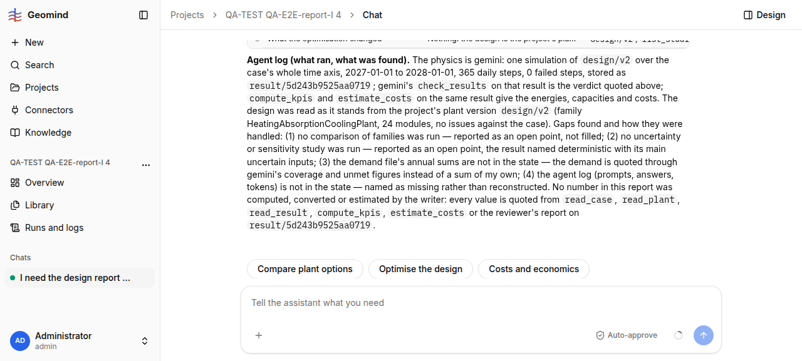

# QA-337: Vague 'design report for the hackathon submission' on a project with plant v1 and v2: agents report only the latest v2 as 'the recommended design' (LCTS 49.28) without simulating v1 (LCTS 45.10, better on cost and CO2)

| Field | Value |
|---|---|
| Status | fixed |
| Severity | major |
| Area | geomind |
| Reporter | QA-E2E-report-I |
| Found | 2026-11-05 19:59 UTC |
| Versions | backend 1.1.122-1.1.125 (geomind 0.4.130+), frontend live |
| Where | https://geomind.team/projects/8b484b52-fee1-48da-96be-8515e44f8d1d/assistant/chat; project QA-TEST QA-E2E-report-I 4; run 124cd4c4-ed91-47f6-87d5-a4a8c5dbcd12 (19:52:04-19:58:00 UTC) |
| Fixer | m7 |

## Steps

1. Project with the reference case, plant v1 HackathonPlant and v2 HeatingAbsorptionCoolingPlant,
   no study run yet.
2. Chat: "I need the design report of this project for the hackathon submission."

## Expected

The project holds two plant versions; a submission report either simulates and compares both
and recommends the better one, or asks which plant to report. From the page studies of
projects 1-3: v1 LCTS 45.10 EUR/MWh, CO2 13.77 kt; v2 LCTS 49.28 EUR/MWh, CO2 20.96 kt.

## Actual

The report covers design/v2 only: "The recommended design is the project's plant as it stands,
design/v2, family HeatingAbsorptionCoolingPlant ... LCTS 49.28 EUR/MWh, CO2 20.96 kt". v1 or
HackathonPlant is not named anywhere in the 851-line answer. It even lists as an open point
"no alternative family was simulated", while one sits in the project. A team submitting this
report would recommend the more expensive, higher-CO2 plant. The v2 numbers themselves are
right (equal to the page study of v2). 5 min 56 s, 89 steps, 1.85 M input tokens, 0.028 USD.

## Evidence

- 
- Answer text: `../evidence/QA-337/answer.txt`

## Cause

Guess: "the project's plant" resolves to the latest plant version (QA-166 cause: the backend
gives the latest version as the project plant), and the project lead does not look at
`list_plants.project_versions` for other versions before writing a report.

## Fix

Proposal (geomind): project lead prompt and handbook-report: when the project holds more than
one plant version and the request does not name one, simulate each current version (cheap: about
1 s each) and compare them, or ask the user which to report; never call the latest one "the
recommended design" without that comparison.
- 2026-11-05 20:01 UTC: geomind acc7b6c + 97ac62d; pending deploy
## Retest

(Who, when, result.)
