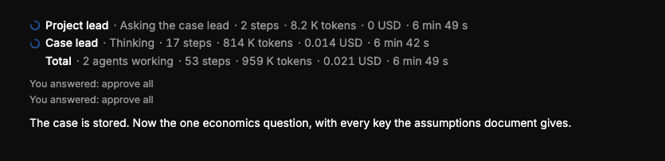

# QA-339: With Auto-approve on, agents must ask the user nothing: no question cards (ask_user, the case confirmation question, ask_economics, step-limit) - take the proposed answer and go on

| Field | Value |
|---|---|
| Status | fixed |
| Severity | major |
| Area | geomind,backend |
| Reporter | Sahand |
| Found | 2026-11-05 19:59 UTC |
| Versions | live 2026-11-05 20:58 Trondheim |
| Where | any chat with Auto-approve on |
| Fixer | hotfix-python-lead-II |

## Steps

1. Turn Auto-approve on in a chat.
2. Ask for a case, economics or design (e.g. upload the files and ask for a heating and cooling design).

## Expected

With Auto-approve on, the run asks the user nothing: no approval cards AND no question cards. Every question the agents would ask (case confirmation, ask_economics, ask_user choices, the step-limit 'go on?' question) is answered automatically with the agents' own proposal (the option they marked recommended / the values they proposed), recorded in the case 'about' as an assumption with its source and 'auto-approved', and the run goes on to the end. The final answer lists the assumptions taken automatically so the user can change them later.

## Actual

Reported by Sahand: with Auto-approve on, the agents still stop and ask the user questions.

## Evidence

Sahand, 2026-11-05 20:58 Trondheim. Screenshot 21:02 Trondheim (): Auto-approve on, the user still answered two questions ('You answered: approve all' twice), and the case lead goes on to 'the one economics question'.

## Cause

Guess: Auto-approve only covers write-tool approvals in the backend; question tools (ask_user, ask_economics, the case confirmation, step limit) are a separate path in geomind and are not auto-answered. Fix in geomind (question tools answer themselves with the proposal when the run's auto_approve flag is on) and the backend (pass the flag, record the auto-answer as an event). Sahand's bug: top priority. Related: QA-292, QA-329.

## Fix

(Hotfix session: cause, commit, version, deployed at.)
- 2026-11-05 20:12 UTC: QA-343 gemini 14d7ab5f (0.6.34); QA-339 geomind e7ccb36; pending deploy
## Retest

(Who, when, result.)

Frontend part: frontend 1.1.140 (commit b30f5f3, bundle index-CzdSC_uX.js), by front-m1: question.auto_answered shows as a settled card 'Answered automatically'.
