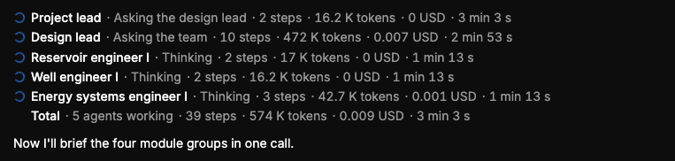
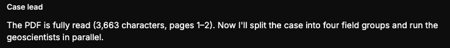

# QA-345: Chat: the live text under the busy list ('Now I'll brief the four module groups in one call.') does not say which agent wrote it; show the agent's name (e.g. 'Design lead: ...')

| Field | Value |
|---|---|
| Status | verified |
| Severity | minor |
| Area | frontend,backend |
| Reporter | Sahand (screenshot) |
| Found | 2026-11-05 20:11 UTC |
| Versions | live 2026-11-05 21:10 Trondheim |
| Where | geomind.team chat, the streamed text line under the busy list during a run |
| Fixer | front-m1 |

## Steps

1. Run a design request; watch the text under the agent list.

## Expected

Every streamed text shows who says it: the agent's name (and instance, e.g. 'Design lead', 'Reservoir engineer I') as a small bold label before the text, in the same name style as the busy list; the final answer to the user stays unlabeled or labeled as the project lead.

## Actual

'Now I'll brief the four module groups in one call.' appears with no agent name; five agents are working (screenshot).

## Evidence

- 

## Cause

Sahand's request (top). text.delta events carry the agent and instance since IMP-025 (backend 1.1.94); the frontend should render it. If a text event lacks the agent, backend adds it.

## Fix

(Hotfix session: cause, commit, version, deployed at.)
- 2026-11-05 20:16 UTC: frontend 1.1.140 (bundle index-CzdSC_uX.js)
- 2026-11-05 20:35 UTC: Sahand: label inline 'Case lead: ...' on the same line, not above
- 2026-11-05 20:42 UTC: frontend 1.1.144 (inline label)
## Retest

(Who, when, result.)
- 2026-11-05 20:43 UTC: Manual QA-IV 21:44 CET, frontend 1.1.145: clean run chat shows 'Case lead: The source field only accepts ...' inline
## Reopened (Sahand, 2026-11-05 21:34 Trondheim)

The label is now on its own line above the text (). Sahand wants it
inline, on the same line, as a bold prefix with a colon: '**Case lead:** The PDF is fully read
(3,663 characters, pages 1-2). Now I'll split the case ...'.

Sahand 21:36 Trondheim: exact form 'Case lead: ...' (name as in the busy list, sentence case, then a colon), inline.
