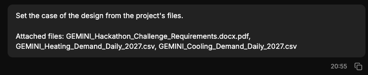

# QA-348: Chat: assistant answers show no time; add the time (and date when not today) next to the copy/log icons, like the user's messages ('20:55')

| Field | Value |
|---|---|
| Status | fixing |
| Severity | minor |
| Area | frontend |
| Reporter | Sahand (screenshot) |
| Found | 2026-11-05 20:16 UTC |
| Versions | live 2026-11-05 21:16 Trondheim |
| Where | geomind.team chat, assistant messages |
| Fixer | front-m2 |

## Steps

1. Look at an assistant answer and a user message in a chat.

## Expected

Each assistant answer shows its time like user messages do (screenshot 2: '20:55' beside the copy icon), with the date when it is not today, in the viewer's local time; same style and position.

## Actual

Assistant answers show only the copy and log icons, no time (screenshot 1).

## Evidence

- 
- 

## Cause

Sahand's request (top). Messages have a created time in the API.

## Fix

(Hotfix session: cause, commit, version, deployed at.)

## Retest

(Who, when, result.)
