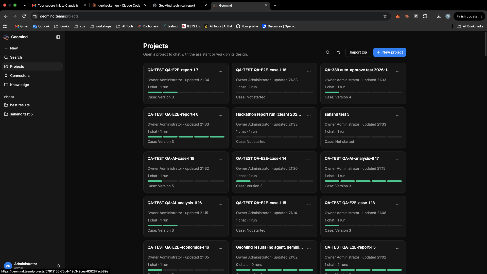

# QA-350: Projects page: sort projects by creation date (newest first) by default, not by last update

| Field | Value |
|---|---|
| Status | open |
| Severity | minor |
| Area | frontend,backend |
| Reporter | Sahand (screenshot) |
| Found | 2026-11-05 20:35 UTC |
| Versions | live 2026-11-05 21:34 Trondheim |
| Where | geomind.team/projects |
| Fixer | |

## Steps

1. Open Projects.

## Expected

Projects are sorted by creation date, newest first, by default (the card may show 'created <date>'); the sort button can still switch to last updated or name, and the choice is remembered. Pagination/search keep the same order (backend list ordered by created desc).

## Actual

Projects are ordered by last update, so the order jumps while QA threads run (screenshot).

## Evidence

- 

## Cause

Sahand's request (top).

## Fix

(Hotfix session: cause, commit, version, deployed at.)

## Retest

(Who, when, result.)
