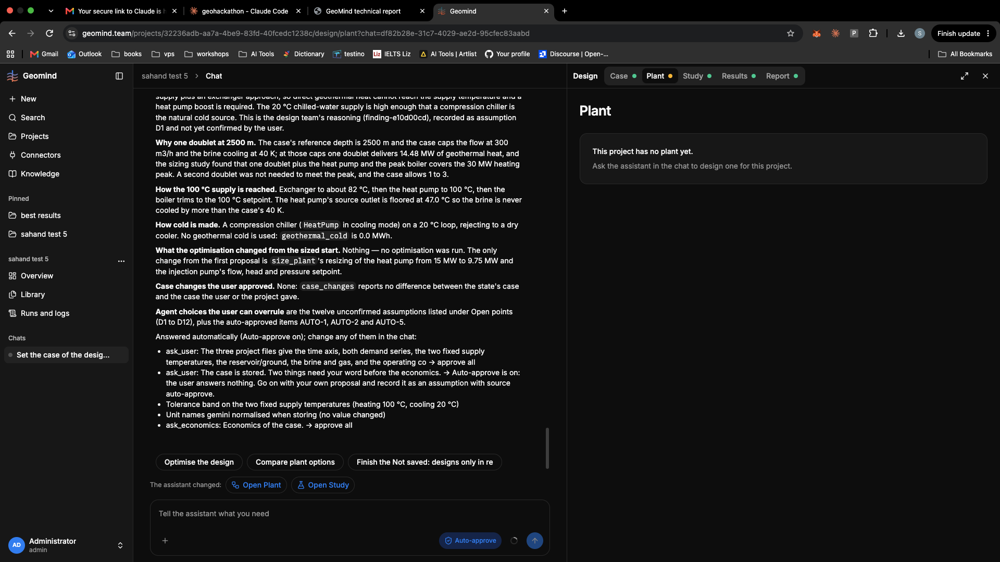

# QA-355: Agent run says it built and sized a plant, but the project has no plant ('Not saved: designs only in results'): the agent's designs stay in the run store and are never saved as a project plant version

| Field | Value |
|---|---|
| Status | open |
| Severity | major |
| Area | geomind,backend |
| Reporter | Sahand (screenshot), Manual QA-IV |
| Found | 2026-11-05 20:54 UTC |
| Versions | backend 1.1.130 (geomind 0.4.135) |
| Where | https://geomind.team/projects/32236adb-aa7a-4be9-83fd-40fcedc1238c (sahand test 5), chat df82b28e, run d935c2b1-7e4b-4235-b9b3-67fdcdd988e8 |
| Fixer | |

## Steps

1. Agent run designs and sizes a plant (state.design.reference = design/hp_boost_sized; study 'hp_boost_sized' run on plants ['design/hp_boost_filled'], result 43359f12-7fc8-490d-930e-38a0294d4e40); the answer describes the plant.
2. Open Design > Plant.

## Expected

The plant the agent built is the project's current plant version (with its flowsheet), so Plant, Study, Results and Report agree.

## Actual

Plant: "This project has no plant yet." GET /workspace/projects/{id}: plant_version null, progress.plant 'incomplete', label 'Not saved: designs only in results'; GET /plant/flowsheet?project=... 404. The study has plant_version null, plant_pinned false.

## Cause

Fact: the agent's design/... references live in the run's store; nothing saves the chosen design (state.design.reference) as a project plant version. The app only offers 'Use this design as the plant' on the result (POST /design/results/{id}/adopt), which the agent does not call and the user does not see from the Plant tab.
Fix: when a run ends (or the comparison picks a design), save state.design.reference as a new plant version (or the agent adopts its verified result); the Plant tab's empty state should link to 'Use this design as the plant' when results hold designs.
Workaround now: Results > the result > 'Use this design as the plant'.

## Evidence

- 

## Fix

## Retest
