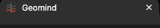

# QA-360: Browser tab title shows the open project: '<project name> · GeoMind' (and the page, e.g. 'Case · <project> · GeoMind')

| Field | Value |
|---|---|
| Status | verified |
| Severity | minor |
| Area | frontend |
| Reporter | Sahand |
| Found | 2026-11-05 21:29 UTC |
| Versions | live 2026-11-05 22:28 Trondheim |
| Where | geomind.team, browser tab title |
| Fixer | hotfix-front-lead |

## Steps

1. Open a project in Chrome.

## Expected

Tab title 'Geomind · <project name>' inside a project (Sahand's order, screenshots 1 and 2); 'Geomind' outside a project.

## Actual

The tab shows the same generic title on every page.

## Evidence

Sahand's request via the coordinator, 22:28 Trondheim.

## Cause

Sahand's request (top); already sent to front-lead.

## Fix

(Hotfix session: cause, commit, version, deployed at.)

Fix: frontend 1.1.148 (bundle index-B5Gm_bU6.js): project-layout.tsx sets document.title to 'Geomind · <project name>' while a project is open and restores 'Geomind' when leaving.
- 2026-11-05 21:32 UTC: frontend 1.1.148
## Retest

(Who, when, result.)

Screenshot:  (tab shows only 'Geomind'). Expected e.g. 'Geomind · sahand test 5'.
- 2026-11-05 21:41 UTC: Manual QA-IV 22:41 CET, frontend 1.1.149 (index-z19tLaSr.js): /projects/8d5d21e0.../design/results title 'Geomind · best results', also after reload; /projects 'Geomind'
