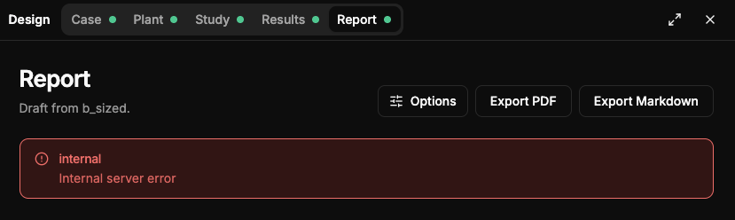

# QA-362: Report page 500 for a sized/study result: document.study_origin calls title_of(objective) with objective None (backend core/gemini/evaluate.py:42 name.replace)

| Field | Value |
|---|---|
| Status | open |
| Severity | blocker |
| Area | backend |
| Reporter | Sahand (screenshot), Coordinator-V (log) |
| Found | 2026-11-05 21:49 UTC |
| Versions | frontend <x.y.z>, backend <x.y.z> (geomind <x.y.z>) |
| Where | <URL>; project <name/id>; chat <id>; run <id>; step <n> |
| Fixer | |

## Steps

1. 
2. 

## Expected

## Actual

## Evidence

- 
- Run JSON: `../evidence/QA-362/run-<id>.json`

## Cause

(Facts, or a guess marked as one.)

## Fix

(Hotfix session: cause, commit, version, deployed at.)

## Retest

(Who, when, result.)
