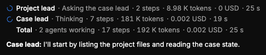

# QA-363: Busy list: an agent that finishes stays in the list with a green circle-check icon instead of the spinner (with its final steps, tokens, cost, time)

| Field | Value |
|---|---|
| Status | open |
| Severity | major |
| Area | frontend |
| Reporter | Sahand (screenshot) |
| Found | 2026-11-05 22:06 UTC |
| Versions | live 2026-11-05 23:05 Trondheim |
| Where | geomind.team chat, busy list during a run |
| Fixer | |

## Steps

1. Run a request; watch an agent finish while others still work.

## Expected

When an agent finishes, its line stays in the list; the spinner is replaced by a green filled circle with a white check, the activity text becomes 'done', and its steps, tokens, cost and time freeze at their final values. Same for every agent; the Total line counts them. (See also QA-341: the whole list stays after the run ends.)

## Actual

A finished agent disappears from the busy list (screenshot shows only the agents still working).

## Evidence

- 

## Cause

Sahand's request (top).

## Fix

(Hotfix session: cause, commit, version, deployed at.)

## Retest

(Who, when, result.)
